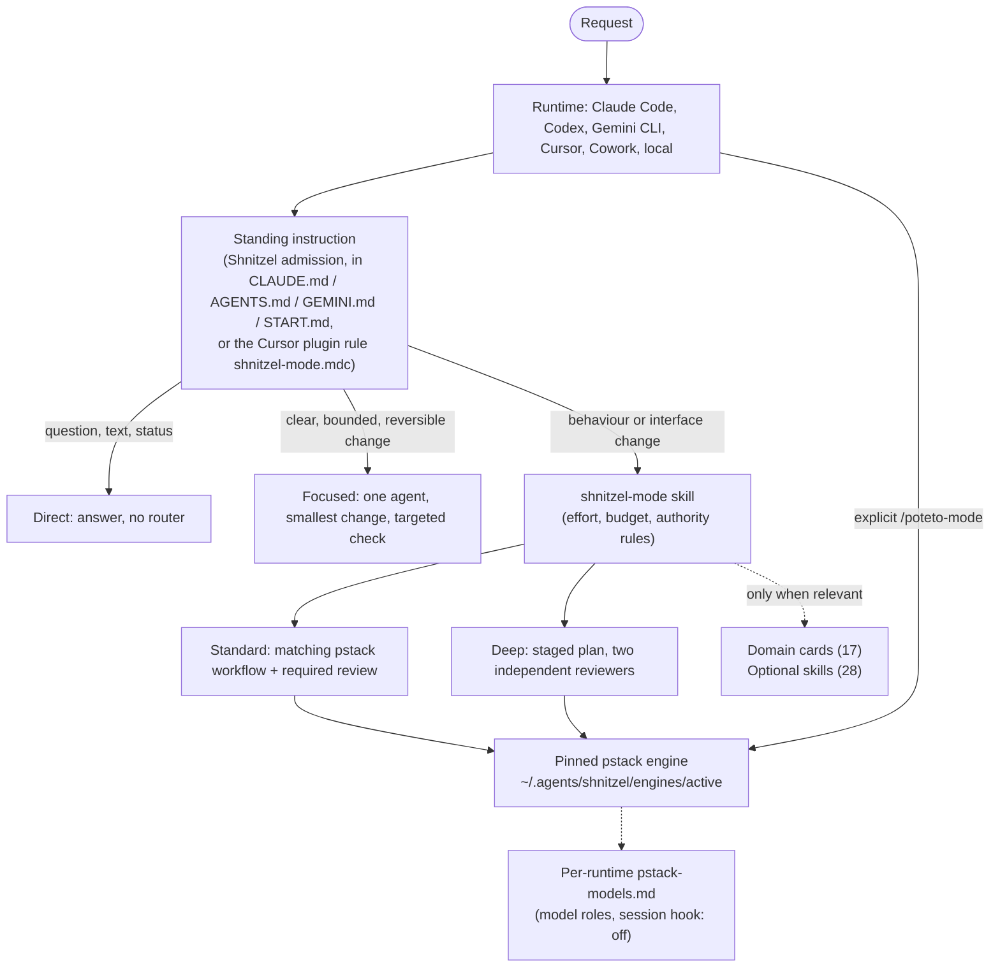
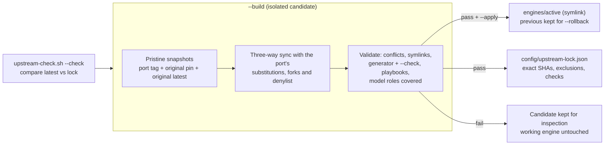
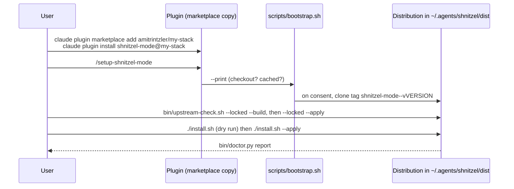
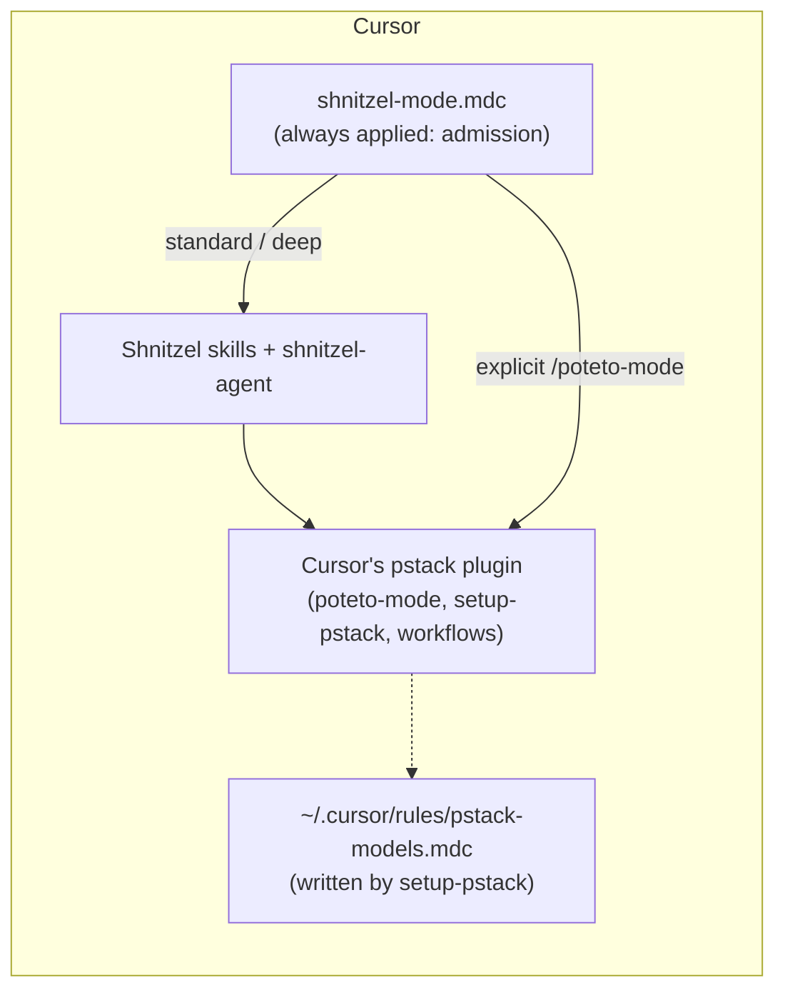

# Architecture

Current for Shnitzel 1.9.0. The engine is pinned to pstack-claude v0.9.133 (`8074b9f`) built on original pstack 0.15.36 (`c742dd6`); `config/upstream-lock.json` is the record. The [1.3 review](architecture-review.md) is historical.

## In one paragraph

Shnitzel does not replace pstack. It sits in front of it. A short standing instruction decides how much process a request deserves: a direct answer, a focused edit, or a real pstack workflow. Ordinary questions and bounded edits never load pstack's router. Larger work loads the matching pstack workflow from a pinned engine, built from Lauren Tan's original pstack through Michael Denyer's cross-runtime port. Saying `/poteto-mode` by name always gets the full upstream behaviour. Around that core sit platform knowledge (domain cards, optional operational skills), read-only collectors, and an honest budget check.

## Layers

| Layer | Owns | Lives in |
| --- | --- | --- |
| Runtime | Tools, files, git, subagents, model choice | The host |
| Standing instruction | Admission and the focused workflow, in about 110 words plus paths | Managed block written by `lib/install.py`; in Cursor, the plugin rule `rules/shnitzel-mode.mdc` |
| Shnitzel router | Effort tiers, approach choices, budget rules, authority | `plugins/shnitzel-mode/skills/shnitzel-mode/` |
| pstack engine | Engineering workflows, playbooks, review panels | `~/.agents/shnitzel/engines/active/plugins/pstack`; in Cursor, Cursor's own pstack plugin |
| Platform layer | Domain cards, optional skills, collectors | `skills/*/`, `domains/`, `bin/` |

## Admission and effort

The standing instruction is the only always-on routing text. It is self-sufficient for focused work, so a one-line fix does not read the router or the config. Before any implementation the user sees two numbered options and a recommendation (aim 60 to 80 words, maximum 120), unless they already chose an approach.

| Tier | Delegates | Documents | pstack router | Recommended effort |
| --- | --- | --- | --- | --- |
| Direct | 0 | no | no | low |
| Focused | 0 | no | no | low |
| Standard | as the workflow requires | when needed | yes | medium |
| Deep | 2 reviewers | yes | yes | high |

Defaults come from [`config/effort-policy.json`](../config/effort-policy.json), with `runtime_overrides` for a specific runtime. Rules that hold at every tier: risk overrides diff size (auth, deletion, production, security get proper checks even for one line); about 20% of an estimated budget is reserved for verification and handoff; two failed rounds trigger a premise check; no tier removes a required correctness check; a sequential self-review is never called independent. The tier is a judgement, not a keyword classifier.

## What is loaded, and when

Context is the cost, so almost everything is loaded on demand.

- **Always:** the managed standing instruction, plus the discovery metadata of linked skills.
- **Linked for discovery by the installer:** `shnitzel-mode`, `setup-shnitzel-mode` and pstack's `poteto-mode`. `--all-skills` links every Shnitzel and pstack skill and costs more standing metadata.
- **Read by path when the router needs it:** `references/effort.md`, `budgets.md`, `runtimes.md`, `scoping.md`, a single domain card, an optional skill, a pstack workflow.
- **Never preloaded:** the 67 pstack skills, the 28 optional skills, the 17 domain cards.

One difference to know about: a marketplace plugin install also registers the plugin folder with the runtime, which lists all 30 of the plugin's own skills and their 30 slash commands, regardless of the installer's three links. The three-skill surface is what a checkout install produces. The Cursor plugin lists the same 30 skills (no separate commands, since Cursor offers skills in its `/` menu) plus its one always-applied rule.

Optional skills cover recurring platform work: `gitops`, `cluster-upgrade`, `pipeline-fix`, `platform-change`, `migration`, `artifact-registry`, `cost-review`, `slo-review`, `access-review`, `dep-sweep`, `incident-drill`, `postmortem-actions`, `oncall-handover`, `watch`, `pr-inbox`, `review-reply`, `feature-flow`, `feature-track`, `prd`, `hld`, `profile-repo`, `lock-in-check`, `learn`, `handoff`, `tune`, `exec-update`, `team-pulse`, `one-on-one`. Domain cards ([`domains/README.md`](../plugins/shnitzel-mode/skills/shnitzel-mode/domains/README.md)) give each platform the same six sections, including read-only commands, the dry run and the exact rollback, so playbooks stay vendor-neutral.

## The pinned engine

Shnitzel never edits pstack content in place. It builds an engine candidate, validates it, and only then switches a symlink.

- `lib/upstream.py` drives it; `lib/sync-upstream.mjs` calls the port's own `tools/sync.mjs` and `tools/generate.mjs`, dry run first. Any denylist hit, undeclared fork, collision or binary conflict stops the build.
- `--locked --build` rebuilds the recorded revisions; `--rollback` restores the previous engine. Sources are cached under `~/.cache/shnitzel/sources`.
- The candidate is refused if pstack's `models.json` names a role Shnitzel's default model sheet does not cover, so a new reviewer role cannot silently fall back to its stamped model.
- Shnitzel's own policy (admission, effort, authority) is not a patch to pstack files. The only place original content can be patched is `patches/upstream/resolutions.json`, by exact base hash; it is empty today.
- Engine moves land as pull requests that change the lock, one port version at a time, each with its CHANGELOG entry. See [upstream-sync.md](upstream-sync.md).

## Install and setup

A marketplace install copies only the plugin folder. The installer, collectors, budget checker and lock live in the wider distribution, so `bootstrap.sh` finds it: the surrounding checkout, a cached copy, or the git tag matching the plugin version. That tag must exist for each release ([publishing.md](publishing.md)). Nothing is built or installed without the user's go-ahead.

`install.sh` (`lib/install.py`) writes only owned things:

- one marked block (`<!-- shnitzel-mode:begin/end -->`) in each runtime's rules file;
- symlinks for the linked skills, refusing to replace a foreign skill of the same name;
- in each runtime's `pstack-models.md`: `session hook: off`, plus any missing role as `inherit-parent`. User lines are never changed.
- an ownership record, so uninstall restores a model sheet only if it was not edited afterwards and never removes someone else's link.

Runtimes: Claude Code, Codex, Gemini CLI, Cursor, a self-contained Cowork folder (`bin/cowork-package.py`) and a local project target. See [runtimes.md](runtimes.md).

### Cursor

pstack started as a Cursor plugin, so Cursor needs no port and no engine build: Cursor's own pstack plugin is the engine, and its skills already speak Cursor's tool names. Shnitzel adds itself as a second plugin.

- The plugin manifest is `plugins/shnitzel-mode/.cursor-plugin/plugin.json` (skills, agents, rules; no commands, no hooks). The repository root `.cursor-plugin/marketplace.json` lists it, for team imports.
- `install.sh --apply cursor` links the plugin folder to `~/.cursor/plugins/local/shnitzel-mode`, Cursor's local plugin directory, with the same ownership rules as skill links. It is not part of the default target set, writes no model sheet and links no skills into `~/.agents/skills`, which Cursor also scans.
- The rule text is generated from the same function as every managed block (`admission()` in `lib/install.py`); a contract test fails if the shipped rule drifts.
- Cursor's marketplace keeps pstack current on its own schedule, so in Cursor the engine is not pinned by `config/upstream-lock.json`.

## Session hook

pstack's own SessionStart mandate is switched off in managed installs, so Shnitzel's standing instruction owns automatic routing. Shnitzel ships its own hook disabled (`hooks/hooks.json.disabled`): enabling it adds roughly 135 tokens on every start, resume, clear and compact. If both hooks run, the injected text says Shnitzel admission comes first. Shnitzel's hook is Claude Code only; the Cursor plugin ships no hook. OpenAI's plugin directory does not take plugins with lifecycle hooks ([publishing.md](publishing.md)), another reason it stays off. See [hooks/README.md](../plugins/shnitzel-mode/hooks/README.md).

## Budgets

An explicit hard token or dollar cap is checked with `bin/budget.py preflight` before any model call. Today no native runtime is recorded as enforcing a cap ([`config/budget-capabilities.json`](../config/budget-capabilities.json)), so such a request stops and offers an alternative rather than pretending. `lib/budget.py` holds a tested ledger (atomic reservations and settlement) for a host that intercepts every model call; it is infrastructure, not an installed gateway. Missing usage is reported as unknown, never zero.

## Collectors and the watch

Collection is deterministic shell with no mutating command: `gh-collect.sh`, `feature-scan.sh`, `scope-check.sh`, `domain-scan.sh`, merged by `digest.sh`. The model only interprets the digest (`watch`, `pr-inbox`, `review-reply`). The digest reports coverage, so a failed query never looks like a healthy empty result, and a PR is "ready" only with completed green checks and a clean merge state. Scheduled runs are read-only and draft only. See [automation.md](automation.md).

## What is verified

- CI on every push: publish check, strict plugin and marketplace validation, 37 contract tests (installer ownership, the Cursor target and rule, version agreement across manifests, budget ledger, collectors, engine rollback), collectors on an empty config, and an installer dry run that must write nothing.
- Each engine move passes the port's generator, generator check and playbook check before it is locked.
- Cursor manifests also pass Cursor's own plugin validator and schemas (run by hand from cursor/plugins, not in CI).
- Not verified: that a model follows a skill. Cursor support has not been run in a live Cursor session. Live runtime acceptance was last recorded for 1.4 on an older engine ([acceptance.md](acceptance.md)). The only measured token figure is one focused fixture, 80,880 to 51,243 total tokens (36.6% fewer); it is not a benchmark median. A full benchmark is planned, not run.

## File map

| Path | Purpose |
| --- | --- |
| `plugins/shnitzel-mode/` | The plugin: skills, commands, agent, disabled hook, Cursor rule and manifest, `scripts/bootstrap.sh` |
| `config/` | Effort policy, upstream lock, budget capabilities, watch example |
| `lib/install.py`, `install.sh` | Owned installation and uninstall |
| `lib/upstream.py`, `lib/sync-upstream.mjs`, `bin/upstream-check.sh` | Engine build, validation, activation, rollback |
| `lib/budget.py`, `bin/budget.py` | Budget preflight and ledger |
| `bin/*-collect.sh`, `bin/*-scan.sh`, `bin/digest.sh`, `lib/digest.py` | Read-only collectors |
| `bin/doctor.py`, `bin/cowork-package.py`, `bin/publish-check.sh` | Diagnostics, Cowork folder, publish gate |
| `tests/test_contracts.py` | Contract tests |
| `docs/` | This document, procedures, evidence; `article.html` is an August essay on the original design |
